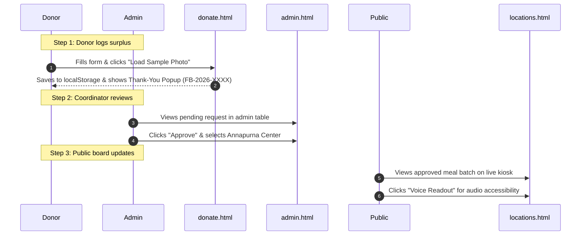

# 🍲 FoodBridge – Connecting Surplus to Smiles
> **"Save Food. Share Hope. Fight Hunger."**  
> *Submission for MY Bharat Hack for Social Cause (2026)*

[](https://github.com/)
[](LICENSE)
[]()
[]()

---

## 📌 Table of Contents
1. [Problem Statement](#-problem-statement)
2. [Proposed Solution](#-proposed-solution)
3. [Key Features](#-key-features)
4. [Technology Stack](#-technology-stack)
5. [Project Architecture Overview](#-project-architecture-overview)
6. [Complete Folder Structure](#-complete-folder-structure)
7. [System Requirements](#-system-requirements)
8. [Step-by-Step Setup Instructions](#-step-by-step-setup-instructions)
9. [Environment Variables](#-environment-variables)
10. [User Guides](#-user-guides)
    - [How to Use the Donation Form](#how-to-use-the-donation-form)
    - [How to Access the Demonstration Admin Dashboard](#how-to-access-the-demonstration-admin-dashboard)
    - [How to Approve or Reject Donation Requests](#how-to-approve-or-reject-donation-requests)
    - [How to View the Public Digital Food Availability Board](#how-to-view-the-public-digital-food-availability-board)
11. [Sample Demonstration Workflow](#-sample-demonstration-workflow)
12. [Project Limitations](#-project-limitations)
13. [Future Enhancements](#-future-enhancements)
14. [UN Sustainable Development Goals (SDG) Alignment](#-un-sustainable-development-goals-sdg-alignment)
15. [License & Credits](#-license--credits)

---

## 🛑 Problem Statement

Across urban centers, an alarming paradox persists daily:
- **Commercial Food Waste:** Large banquets, wedding receptions, luxury hotels, and corporate cafeterias routinely cook 15% to 30% more food than consumed as a buffer. By late evening, metric tons of wholesome, safe food are discarded into municipal landfills, generating harmful methane emissions.
- **Urban Hunger & The Digital Divide:** Low-income families, daily wage laborers, shelter residents, and destitute citizens frequently miss evening meals. Conventional food donation apps require modern smartphones, data connections, and app literacy—technological barriers that exclude the most vulnerable citizens.

---

## 💡 Proposed Solution

**FoodBridge** is an agile, civic food redistribution platform that connects commercial food donors with community distribution centers.

- **Frictionless Donor Intake:** Banquets and caterers submit surplus details in under 2 minutes.
- **Verification & Logistics Dispatch:** Coordinators evaluate freshness windows, hygiene standards, and dispatch insulated thermal transport crews.
- **Smartphone-Free Public Signage:** Verified meals are broadcast onto a high-contrast **Digital Food Availability Board** simulated for public kiosks and community shelters, enabling anyone to see warm meal availability without owning a mobile device.

---

## ✨ Key Features

1. **Awareness & Impact Portal (`index.html`):**
   - Modern social-impact visual design with responsive layouts, fluid micro-interactions, and vibrant warm styling.
   - Interactive 4-step logistics breakdown.
   - Three key impact metric showcases (meals rescued, partner kitchens, emissions prevented).
   - Global alignment with UN Sustainable Development Goals (SDG 2, 11, and 12).

2. **Validated 11-Point Donation Intake (`donate.html`):**
   - Captures Contact Person, Venue/Organization, 10-digit Phone, Exact Pickup Location, Food Items, Quantity (KG), Beneficiary Estimates, Prep Timestamp, Photographic Evidence, Reason, and Storage Notes.
   - Immediate photo preview powered by the HTML5 `FileReader` and Canvas compression engine.
   - Generates unique tracking ID `FB-2026-XXXX`.
   - Displays an animated celebratory modal:
     > *"🎉 Thank You for Donating! Your request has been submitted successfully. Our FoodBridge team will contact you soon! 💚"*

3. **Public Community Signage (`locations.html`):**
   - High-contrast outdoor LED kiosk simulation.
   - Real-time live IST clock ticker.
   - Dynamic synchronization with approved `localStorage` records.
   - Filter by neighborhood distribution center.
   - Built-in **Voice Readout** using the browser Web Speech API for visually impaired and low-literacy citizens.

4. **Demonstration Administrative Console (`admin.html`):**
   - Real-time stat metrics: Total Requests, Pending Review, Approved & Live, and Rejected Requests.
   - Filter tabs, instant search bar, and full-resolution photograph preview modal.
   - Dedicated **Approve & Dispatch** modal with distribution center assignment.
   - Instant exclusion of rejected batches from public digital boards.
   - Pre-loaded mock request generators and data reset buttons for evaluation.

---

## 🛠️ Technology Stack

FoodBridge is designed to be completely zero-dependency and lightweight:

- **HTML5:** Semantic document architecture.
- **CSS3:** Custom variables, responsive grid/flexbox layouts, keyframe animations.
- **Vanilla JavaScript (ES6+):** Client-side state handling, DOM manipulation, Canvas compression.
- **Browser Web Storage (`localStorage`):** Client-side key-value store simulating database persistence.
- **Web Speech API (`SpeechSynthesis`):** Simulated outdoor kiosk voice announcements.
- **Iconography & Typography:** Font Awesome Free 6.5.1 CDN & Google Fonts (*Outfit* and *Plus Jakarta Sans*).

*No Node.js, React, npm, Firebase, or external SQL database required.*

---

## 🏗️ Project Architecture Overview

```
[Donor (Hotel/Caterer)]
         │
         ▼
[Donation Form (donate.html)]
         │ (Validation + Canvas Compression)
         ▼
[Browser LocalStorage (foodbridge_donations_v1)]
         │
         ├──► [Admin Dashboard (admin.html)] ──► [Safety Inspection & Center Assignment]
         │                                              │
         │                                        (Status = "Approved")
         │                                              │
         └──► [Live Digital Board (locations.html)] ◄───┘
                       │
                       ▼
         [Beneficiaries (No Smartphone Needed)]
```

---

## 📂 Complete Folder Structure

```
FoodBridge/
├── index.html                  # Homepage (Public awareness, 4 steps, impact, SDGs)
├── donate.html                 # Donation portal (11 validated fields, instant preview)
├── locations.html              # Sample centers & live Digital Availability Board
├── admin.html                  # Demonstration Administrator Console
├── README.md                   # Complete project documentation & guide
├── LICENSE                     # Standard MIT Open-Source License
├── CREDITS.md                  # Team placeholders, asset attribution, and acknowledgments
├── .gitignore                  # Git repository exclusion rules
├── css/
│   └── style.css               # Central responsive stylesheet & animations
├── js/
│   ├── storage.js              # LocalStorage manager, seed records, and status updates
│   ├── main.js                 # Shared navigation, toast notification system, mobile menu
│   ├── donate.js               # Form validation, canvas image scaler, modal triggers
│   ├── locations.js            # Digital kiosk renderer, IST clock, speech synthesis
│   └── admin.js                # Admin counters, approval modals, and filtering
├── docs/
│   └── TECHNICAL_DESIGN.md     # In-depth technical architecture & Mermaid diagrams
├── sample-data/
│   └── donations.json          # Fictional donation records for evaluation
└── tests/
    └── TEST_CASES.md           # 16 detailed manual and functional test cases
```

---

## 💻 System Requirements

To run and evaluate the prototype, you only need:
- Any modern web browser (**Google Chrome**, **Microsoft Edge**, **Mozilla Firefox**, or **Apple Safari**).
- *(Optional for development)* **Visual Studio Code** with the **Live Server** extension.

---

## 🚀 Step-by-Step Setup Instructions

### Method A: VS Code Live Server (Recommended)
1. Launch **Visual Studio Code**.
2. Click **File** ➔ **Open Folder...** and select the `FoodBridge` project directory.
3. If not already installed, install the **Live Server** extension:
   - Press `Ctrl + Shift + X` (Windows) or `Cmd + Shift + X` (macOS).
   - Search for **Live Server** (by Ritwick Dey) and click **Install**.
4. In the left Explorer pane, right-click `index.html` and click **"Open with Live Server"**.
5. Your browser will automatically open:
   ```
   http://127.0.0.1:5500/index.html
   ```

### Method B: Direct Browser Launch (Zero Installation)
1. Open your operating system file manager and navigate to the `FoodBridge` folder.
2. Double-click `index.html` to open it in your default web browser.

---

## 🔐 Environment Variables

**No environment variables or API keys are required.**

The application runs entirely on open web standards and client-side browser storage (`localStorage`). You can clone and run it immediately without `.env` files or server provisioning.

---

## 📖 User Guides

### How to Use the Donation Form
1. Click **Donate Food** in the top navigation or open `donate.html`.
2. Fill in the organization, donor contact person, 10-digit phone number, and pickup venue.
3. Enter the food dishes available, quantity in KG, and estimated beneficiary count.
4. Upload a food photo from your computer (or click *"Or Load Sample Food Photo"* for testing).
5. Select a donation reason (*Wedding*, *Hotel Surplus*, etc.) and add handling notes.
6. Click **Submit Surplus Food Donation**.
7. The animated modal confirms submission with a unique tracking code (e.g., `FB-2026-1048`) and sets status to **Pending**.

### How to Access the Demonstration Admin Dashboard
1. The admin dashboard is intentionally kept out of the main public navigation.
2. Access it either:
   - Via the footer link: **"Demo Admin Dashboard"**, or
   - Directly opening `admin.html` in your browser.

### How to Approve or Reject Donation Requests
1. In `admin.html`, pending donations appear under the **Pending** tab.
2. Click the food image thumbnail to inspect the full-resolution dish photo.
3. To **Approve**:
   - Click the green **Approve** button.
   - In the modal, choose the destination center (*Seva Kendra*, *Annapurna*, or *Hope Care*).
   - Click **Confirm Approval & Broadcast**. The donation instantly goes live on the public board.
4. To **Reject**:
   - Click the red **Reject** button.
   - Confirm the prompt. The donation status updates to **Rejected** and is excluded from the digital board.

### How to View the Public Digital Food Availability Board
1. Open `locations.html` and scroll down to the **Community Digital Food Board** section.
2. Observe the high-contrast display with real-time approved dishes, meal counts, and assigned distribution centers.
3. Use the dropdown to filter by specific distribution center.
4. Click **Voice Readout** to hear the simulated audio broadcast for non-smartphone accessibility.

---

## 🧪 Sample Demonstration Workflow (90-Second Walkthrough)

To experience the full end-to-end integration during an evaluation:



---

## ⚠️ Project Limitations

> [!IMPORTANT]
> **Prototype Demonstration Notice:**
> 1. **Client-Side Storage Isolation:** Data is stored in the browser's `localStorage`. Data submitted in one browser profile (e.g. Chrome) persists across tabs in that same browser, but does **not** synchronize to different physical computers or mobile phones without a backend database.
> 2. **Authentication:** The `admin.html` page is an open demonstration view for hackathon evaluation and does not implement server-side JWT or OAuth authentication.
> 3. **Demonstration Data:** Distribution center addresses, phone numbers, and volunteer hotlines are simulated demonstration assets.
> 4. **Storage Quotas:** Browser `localStorage` is capped at ~5MB; the built-in HTML5 Canvas engine compresses uploaded images to prevent exceeding this quota.

---

## 🔮 Future Enhancements

- [ ] **Backend Database Migration:** Transition from `localStorage` to Node.js/Express with PostgreSQL.
- [ ] **Role-Based Access Control (RBAC):** Secure coordinator logins and donor verification via SMS OTP.
- [ ] **Physical IoT LED Kiosks:** Microcontroller-driven (ESP32/Raspberry Pi) physical LED boards installed outside municipal shelters.
- [ ] **GPS Fleet Tracking:** Real-time driver app for insulated food rescue vans.
- [ ] **Predictive Surplus AI:** Machine learning models estimating surplus volumes based on banquet calendar schedules.

---

## 🎯 UN Sustainable Development Goals (SDG) Alignment

- **SDG 2: Zero Hunger (Target 2.1 & 2.2):** Ensuring access to safe, nutritious food for vulnerable populations.
- **SDG 11: Sustainable Cities & Communities (Target 11.1):** Deploying smartphone-free public boards to integrate marginalized citizens into urban civic welfare.
- **SDG 12: Responsible Consumption and Production (Target 12.3):** Halving per capita food waste at retail and consumer levels to eliminate landfill degradation.

---

## 📄 License & Credits

- **Source Code License:** Released under the [MIT License](LICENSE).
- **Project Team & Attribution:** See [`CREDITS.md`](CREDITS.md) for team placeholders, technology credits, and third-party media acknowledgments.
