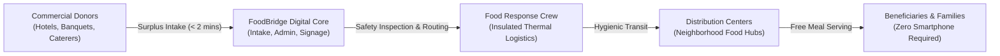
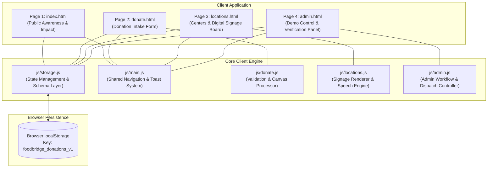
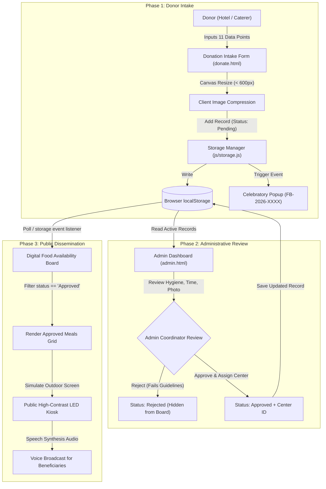
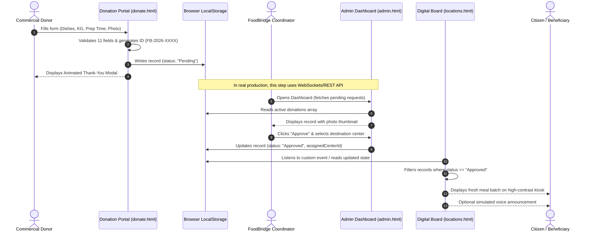
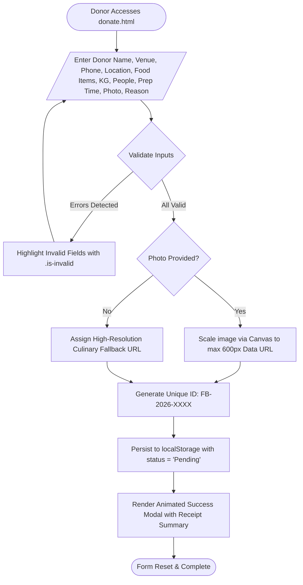
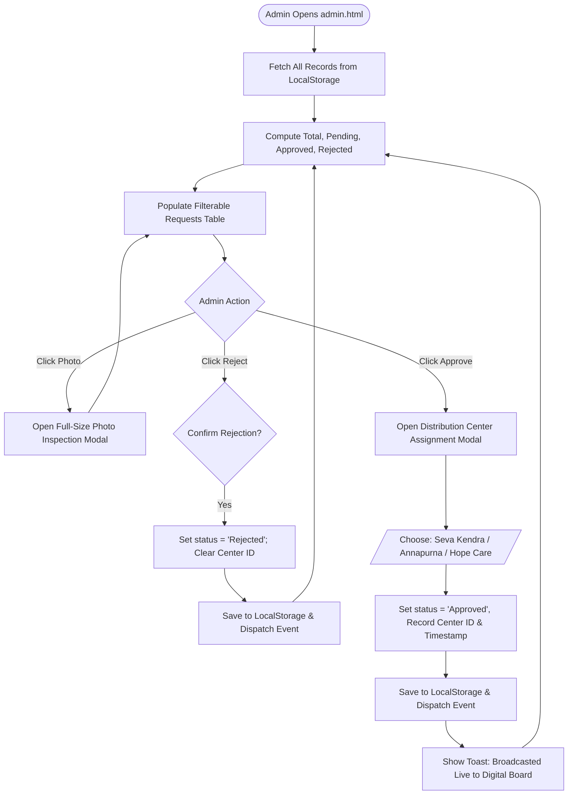
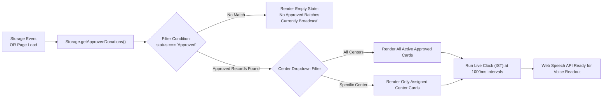
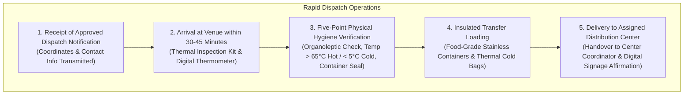
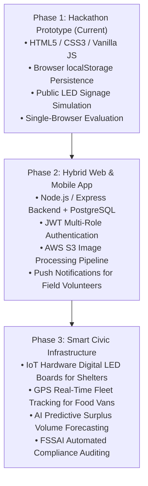

# FoodBridge – Technical Design Document (TDD)
> **System Name:** FoodBridge – Connecting Surplus to Smiles  
> **Initiative:** MY Bharat Hack for Social Cause (2026)  
> **Document Version:** 1.0.0 (Phase 2 Prototype Submission)  
> **Status:** Active Demonstration Prototype

---

## 1. Project Overview

FoodBridge is a localized food redistribution platform engineered to prevent commercial food waste and alleviate urban hunger. It bridges the gap between commercial food donors (wedding banquets, luxury hotels, corporate caterers, community event organizers) and urban underprivileged beneficiaries who lack access to daily nutrition.

The system addresses two interconnected social challenges:
1. **The Commercial Food Waste Crisis:** Tons of hygienic, freshly prepared meals are discarded daily following private banquets and events due to a lack of immediate, zero-friction redistribution logistics.
2. **The Urban Digital Divide:** Destitute and food-insecure individuals frequently lack smartphones, mobile data, or digital literacy, locking them out of conventional app-based aid networks.

FoodBridge solves both dilemmas through a donor-friendly web portal coupled with a simulated **Public Digital Food Availability Board**—a high-contrast public LED kiosk interface displaying live meal availability directly at neighborhood distribution centers.

---

## 2. Problem and Solution Architecture

### 2.1 Problem Analysis
Commercial banquets operate on rigid catering buffers, often producing 15% to 30% more food than consumed. By 10:00 PM, banquets face the logistical dilemma of discarding surplus or paying disposal costs. Concurrently, urban shelters, pavement dwellers, and low-income daily wagers struggle for evening sustenance.

### 2.2 Proposed Solution Architecture
FoodBridge decouples the donor intake from beneficiary consumption through an intermediate verification and logistics layer operated by a rapid **Food Response Crew**:



---

## 3. Technology Stack

To ensure that judges and reviewers can run and evaluate the prototype immediately without complex environment provisioning, container setups, or cloud database credentials, the prototype is built strictly using open client-side web standards:

| Component | Technology | Rationale & Trade-offs |
| :--- | :--- | :--- |
| **Markup Layer** | HTML5 (Semantic) | Accessible document outline, zero dependency, universal browser compatibility. |
| **Styling & Theme** | CSS3 (Custom Properties & Flex/Grid) | Native responsive design; zero compilation (no SASS/Tailwind required); smooth transitions and animations. |
| **Client Logic** | Vanilla JavaScript (ES6+) | Native DOM manipulation, async FileReader API, Canvas compression; fast execution without runtime baggage. |
| **Local Persistence** | Web Storage API (`localStorage`) | Demonstrates stateful submission, admin review, and digital signage updates locally within the browser session. |
| **Audio Signage** | Web Speech API (`SpeechSynthesis`) | Demonstrates audio accessibility for citizens with visual impairments or low literacy. |
| **Iconography & Fonts** | Font Awesome Free 6.5.1 & Google Fonts | Professional visual identity using Outfit and Plus Jakarta Sans. |

---

## 4. System Components

The prototype is organized into five decoupled presentation and logic components:



---

## 5. Detailed System Architecture

The primary architectural pipeline connects the physical donor intake to the public digital board:



---

## 6. Data Flow Diagram



---

## 7. Donation Process Flowchart



---

## 8. Admin Approval Workflow

The administrator dashboard evaluates incoming food donations against municipal food safety protocols:



---

## 9. Digital Board Update Workflow



---

## 10. Data Storage Structure

The prototype schema persists under the key `foodbridge_donations_v1` in `localStorage`:

```json
{
  "id": "FB-2026-1042",
  "donorName": "Chef Sanjeev Mehra",
  "orgName": "The Royal Heritage Banquet",
  "phone": "9876501234",
  "pickupLocation": "Hall 3, Grand Ballroom, Ring Road Wing",
  "foodItems": "Veg Dum Biryani, Paneer Butter Masala, Fresh Rotis, Gulab Jamun",
  "quantityKg": 38.0,
  "peopleServed": 95,
  "prepDateTime": "2026-10-12T15:30",
  "photoUrl": "data:image/jpeg;base64,... (or verified image URL)",
  "reason": "Wedding",
  "notes": "Packed in food-grade foil containers. Kept heated in warm buffet trays.",
  "status": "Approved",
  "assignedCenterId": "center-1",
  "createdAt": "2026-10-12T16:10:00.000Z",
  "approvedAt": "2026-10-12T16:25:00.000Z"
}
```

### Field Definitions:
- `id` *(String, Primary Key)*: Auto-generated alphanumeric identifier with format `FB-2026-[1000-9999]`.
- `donorName` *(String)*: Full contact person name (validated min length: 2 chars).
- `orgName` *(String)*: Registered business or venue name.
- `phone` *(String)*: Contact phone number (validated 10 numeric digits).
- `pickupLocation` *(String)*: Exact pickup point, gate number, or ward location.
- `foodItems` *(String)*: Free-text inventory of available dishes.
- `quantityKg` *(Number)*: Surplus volume in kilograms (validated > 0).
- `peopleServed` *(Integer)*: Estimated beneficiaries fed (validated >= 1).
- `prepDateTime` *(String, ISO format)*: Timestamp when the food was cooked.
- `photoUrl` *(String, Base64 Data URL or HTTP URL)*: Visual verification asset.
- `reason` *(Enum)*: One of `["Wedding", "Event", "Hotel Surplus", "Charity", "Other"]`.
- `notes` *(String, Optional)*: Storage conditions, temperature history, and dietary guidelines.
- `status` *(Enum)*: One of `["Pending", "Approved", "Rejected"]`.
- `assignedCenterId` *(String, Nullable)*: References one of the distribution centers (`center-1`, `center-2`, `center-3`).
- `createdAt` *(String, ISO Timestamp)*: Intake timestamp.
- `approvedAt` *(String, Nullable, ISO Timestamp)*: Verification timestamp.

---

## 11. Food Response Crew Responsibilities

In a real-world municipal deployment, the physical verification and rapid transport bridge is staffed by the **Food Response Crew**:



---

## 12. Food Safety & Hygiene Considerations

Food safety is paramount in social food rescue. FoodBridge aligns with the guidelines outlined by the **Food Safety and Standards Authority of India (FSSAI) "Save Food Share Food"** framework:

1. **The 4 to 6 Hour Critical Consumption Window:** Cooked perishable foods kept at ambient room temperatures must be distributed and consumed within 4 to 6 hours of cooking, or immediately chilled below 4°C.
2. **Thermal Chain Preservation:** Hot foods must be maintained above 60°C during transport; cold perishable items must be transported below 5°C.
3. **Packaging Integrity:** High-risk foods (unsealed dairy gravies, raw salads, unpasteurized items) are restricted unless hermetically sealed by commercial kitchens.
4. **Mandatory Donor Declaration:** Donors declare preparation time and storage conditions prior to pickup acceptance.

---

## 13. Security & Prototype Limitations

This prototype is intentionally architected as a lightweight, zero-dependency client application. As such, the following limitations apply:

| Prototype Limitation | Technical Explanation | Production Path |
| :--- | :--- | :--- |
| **Client-side `localStorage`** | Data is isolated to the single browser profile in which it was submitted. It does not synchronize across separate devices. | Cloud SQL / PostgreSQL / MongoDB backend with REST/GraphQL endpoints. |
| **Demo Admin Access** | `admin.html` is open to any user navigating to its URL; no server-side session authentication exists. | OAuth 2.0 / JWT session cookies with Role-Based Access Control (RBAC). |
| **Image Storage Constraints** | Base64-encoded images in `localStorage` are limited by browser quotas (~5MB total storage). | Direct multipart uploads to AWS S3 / Cloudflare R2 / Google Cloud Storage with CDN delivery. |
| **Mock Locations & Phone Numbers** | Sample distribution centers and hotline numbers are simulated artifacts for hackathon demonstration. | Municipal GIS mapping and verified civic NGO partnerships. |

---

## 14. Future Scalability & Architecture Roadmap

To transition FoodBridge from this hackathon prototype to a city-wide civic utility, the following evolutionary roadmap is proposed:


